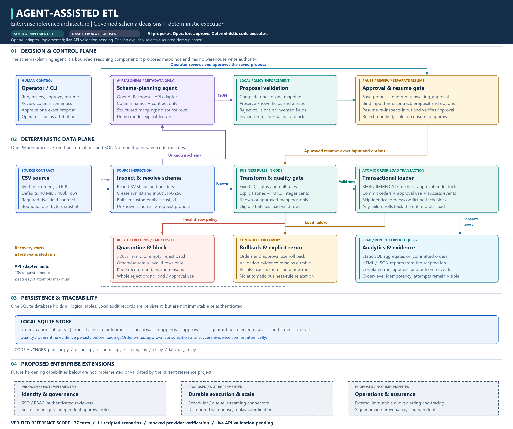

# Agent-Assisted ETL: Schema Drift, Approvals & Recovery

A Python reference implementation for maintaining CSV ingestion pipelines under schema drift. OpenAI proposes mappings for unknown column names; reviewed, deterministic code controls validation, quarantine, loading and recovery.

**Scope:** synthetic orders, local SQLite state, CLI-first operations. The repository demonstrates engineering controls; it does not claim a production deployment or compliance certification.

[Architecture](docs/ARCHITECTURE.md) | [Operator runbook](docs/OPERATIONS.md) | [Data contract](docs/DATA_CONTRACT.md) | [Validation evidence](docs/VALIDATION.md) | [Documentation index](docs/README.md)

## Architecture

The CLI coordinates a deterministic ETL application. SQLite holds warehouse orders, proposals, approvals, run state, quarantine and audit in **one database**. The core handles inspection, mapping checks, approval enforcement, fixed transformations, quality gating and transactional loading.

[](docs/assets/architecture.png)

[Full-size PNG](docs/assets/architecture.png) | [Editable SVG](docs/assets/architecture.svg)

Unknown schemas **stop after saving a validated proposal**. An operator approves it, then a separate resume command re-inspects the input and verifies its binding. Only eligible batches reach loading: empty batches or batches with more than 20% invalid rows are wholly quarantined. Otherwise, invalid rows are retained and valid rows proceed. Loading atomically commits orders, approval consumption and success events; any conflict rolls them back. Analytics is requested separately by the CLI or lab.

See the [execution flow and transaction sequence](docs/ARCHITECTURE.md) for the explicit branch conditions and recovery boundary.

Only the schema planner uses a model. Source rows are never sent to OpenAI. Model output is never executed as Python or SQL. Unknown schemas fail closed when planning fails. `DemoPlanner` is an explicitly selected scripted fixture, independent of live mode.

| Control | Implemented behavior |
|---|---|
| Source boundary | UTF-8 CSV, bounded bytes/records/headers, SHA-256 of the exact bytes consumed |
| Mapping gate | Complete one-to-one mapping, known-field preservation, no invented or dropped fields |
| Approval binding | Exact input, contract, saved proposal and currency options; rechecked under load lock |
| Contract | Nonempty IDs, explicit timestamp zones normalized to UTC, fixed statuses, integer cents |
| Quality gate | More than 20% invalid rejects the entire batch; otherwise valid rows load and invalid rows are retained |
| Transaction | Orders, approval consumption, success state and success audit commit together |
| Recovery | Failed loads roll back; identical existing orders skip; conflicting records block the load |
| Operations | JSON outcomes, stable error codes, run/audit/quarantine queries, integrity check and verified backup utility |
| Engineering | Typed modules, lint/format/type checks, branch coverage gate, package build and security workflows |

## Quick start

Requires Python 3.11+. The complete fixture lab needs no API key and makes no network calls.

Windows PowerShell:

```powershell
python -m venv .venv
.venv\Scripts\python -m pip install -e ".[dev]"
.venv\Scripts\python lab/run_lab.py
.venv\Scripts\python scripts/verify.py --build
```

macOS/Linux:

```sh
python3 -m venv .venv
.venv/bin/python -m pip install -e ".[dev]"
.venv/bin/python lab/run_lab.py
.venv/bin/python scripts/verify.py --build
```

After installation, **`python lab/run_lab.py`** runs the entire scripted demonstration. It creates a new SQLite file on every invocation and writes:

- `output/lab/report.html`: scenario outcomes, SQL analytics and an expandable audit trail.
- `output/lab/results.json`: machine-readable scenario and audit evidence.
- `output/lab/lab-<id>.db`: the corresponding warehouse and control state.

Reports reflect the latest run; earlier databases are preserved. Generated output and credentials are excluded from git. The guided [45-60 minute lab](lab/LAB_GUIDE.md) explains each control.

## CLI workflow

Use the environment's Python, or activate the environment to use `etl-agents`. Global options precede the subcommand.

```sh
etl-agents inspect data/clean.csv
etl-agents --db output/manual.db run data/clean.csv
etl-agents --db output/manual.db run data/alias.csv
etl-agents --db output/manual.db run data/currency.csv --us-thousands
etl-agents --db output/manual.db run data/unknown.csv --planner demo
etl-agents --db output/manual.db proposals
etl-agents --db output/manual.db approve PROPOSAL_ID --operator reviewer-name
etl-agents --db output/manual.db run data/unknown.csv --approval PROPOSAL_ID
etl-agents --db output/manual.db runs
etl-agents --db output/manual.db quarantine --run-id RUN_ID
etl-agents --db output/manual.db audit --run-id RUN_ID
etl-agents --db output/manual.db analytics
etl-agents --db output/manual.db health
```

Substitute returned proposal/run IDs. Awaiting approval exits 2; quarantine/failure exits 1; successful and idempotent loads exit 0. Argument errors also use exit 2, so automation should inspect JSON `status`. `python -m etl_agents` is equivalent to the installed command. See the [CLI reference](docs/CLI_REFERENCE.md) for limits and error categories.

Recovery example:

```sh
etl-agents --db output/recovery.db run data/recovery.csv --fail-after 1
etl-agents --db output/recovery.db run data/recovery.csv
etl-agents --db output/recovery.db run data/recovery.csv
```

Expected new committed orders: **0, then 2, then 0**. The first command intentionally fails. Conflicts also roll back the complete batch; records are never silently overwritten.

## Data contract

Required fields: `order_id`, `customer_id`, `amount`, `created_at`, `status`. `cust_id` is a preapproved alias; `client_ref` requires a reviewed proposal. Amounts are nonnegative, have at most two decimal places and are stored as integer cents. Empty amounts are permitted only for pending orders. Comma grouping requires explicit `--us-thousands` and valid CSV quoting. Supported statuses are `paid`, `pending`, `cancelled`. See the [complete contract](docs/DATA_CONTRACT.md).

## Live planner configuration

Set `OPENAI_API_KEY` in the execution environment using your secret-management process. Never commit it. `OPENAI_MODEL` defaults to `gpt-4o-mini` and must support structured outputs in the target account. `.env.example` documents names; environment files are not loaded automatically.

```sh
etl-agents --db output/live.db run data/unknown.csv --planner live
```

The adapter uses the [Responses API structured output format](https://developers.openai.com/api/docs/guides/structured-outputs), a 20-second request timeout and at most two retries for transient failures. Refusals, incomplete output, invalid mappings and provider failures block unknown schemas. Raw provider exception text is excluded from application reports. Live API validation remains pending; all automated provider tests use mocks.

## Verification

**Local evidence:** 77 passing tests, 98.62% application coverage with branch measurement, 11 verified lab scenarios, and a 59-package advisory scan reporting no known vulnerabilities. Lint, formatting, typing, static security analysis and distribution builds passed. Live API and local Docker validation remain pending.

```sh
python scripts/verify.py --build
```

This runs lint, formatting, typing, pytest with branch measurement, static security analysis, dependency consistency, the full lab and an sdist/wheel build. Command outcomes and logs are saved under `output/verification/`. The application coverage gate is 85%.

Individual commands:

```sh
python -m pytest --cov --cov-report=term-missing
python -m ruff check .
python -m ruff format --check .
python -m mypy
python -m bandit -c pyproject.toml -r src/etl_agents
python -m build
python -m pip_audit -r requirements/constraints.txt --no-deps --disable-pip --strict --progress-spinner off
```

The advisory audit scans the recorded dependency snapshot, requires network access and runs separately. It does not resolve a new environment. CI defines Python 3.11-3.14 on Linux, Python 3.14 on Windows, package validation, artifact retention, and separate security/container workflows. Repository rules and hosted workflow execution must be verified independently. See [VALIDATION.md](docs/VALIDATION.md) for the actual local results and gaps.

## Expected demonstration results

Eleven scenario checks exercise clean input, approved alias, US currency, both quarantine thresholds, unknown schema, approved resume, injected failure, recovery, idempotency and conflict rollback.

| Warehouse status | Orders | Total cents |
|---|---:|---:|
| paid | 10 | 134706 |
| pending | 1 | 0 |

Pending NULL amounts contribute zero to the aggregate. All fixtures assume one currency. Expected failures are asserted by the lab; the complete script exits successfully only when those controls behave as intended.

## Repository structure

```text
.github/                 CI/security/container workflows, ownership and review templates
src/etl_agents/          Typed contract, planner, storage, pipeline and CLI
tests/                  Contract, transaction, provider, governance and operator tests
data/                   Synthetic CSV fixtures
lab/                    Scripted demo, report renderer and guided exercise
scripts/                Verification runner and verified SQLite backup
docs/                   Architecture, ADRs, controls, threat model and runbooks
requirements/           Verified dependency-version snapshot and usage notes
pyproject.toml          Package metadata, dependencies and quality-gate configuration
Dockerfile              Multi-stage, non-root batch runtime
```

## Operational boundaries

SQLite is a local single-writer store and batches remain in memory within explicit limits. Operator names are attribution, not authentication. Approval checksums detect mutation but are not cryptographic signatures against a privileged database writer. Audit storage is persistent but locally mutable. No wall-clock approval expiration, multi-tenant isolation, external orchestration or automatic retention is implemented. [Production readiness](docs/PRODUCTION_READINESS.md) identifies the additional controls required for real workloads.

The [container guide](docs/DEPLOYMENT.md), [release process](docs/RELEASING.md), [contribution guide](CONTRIBUTING.md), [security policy](SECURITY.md) and [support guidance](SUPPORT.md) define operational expectations. MIT licensed; see [LICENSE](LICENSE).
