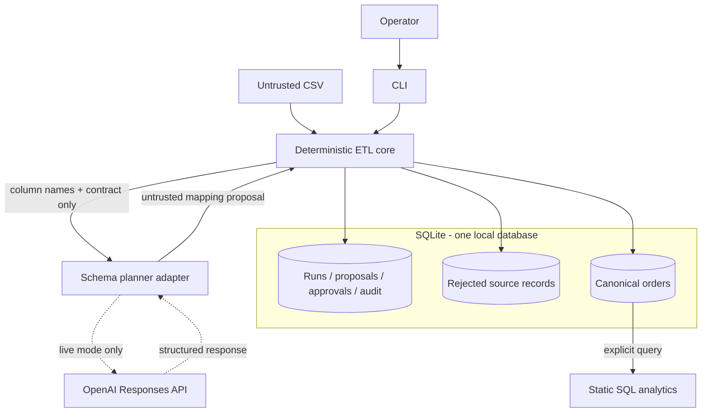
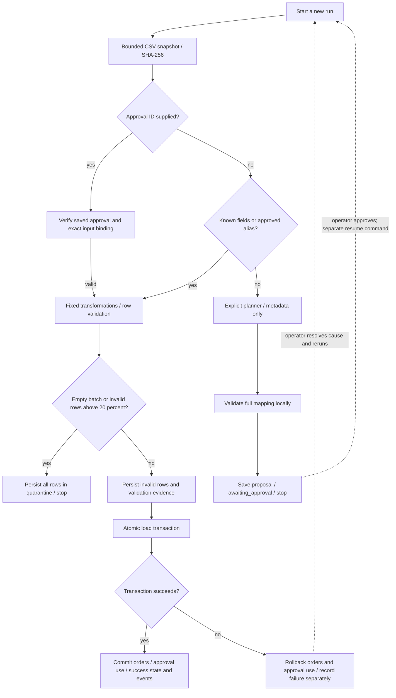

# Architecture

## Component boundaries

The application separates uncertain schema reasoning from deterministic data handling. A CSV batch is the execution unit; `order_id` is the warehouse identity. The source is inspected once into a bounded byte snapshot, and its SHA-256 binds the subsequent approval and load.



The planner adapter can use the live Responses API or an explicitly selected scripted fixture. Known schemas bypass it. Table groups are logical views of one SQLite file, not independently deployed services. The application writes control state throughout execution, including on failed runs; auditing is not a final step after loading.

| Module | Responsibility | External effects |
|---|---|---|
| config | Contract identity and source resource limits | None |
| planner | Proposal generation and local mapping validation | Optional Responses API request |
| contract | Currency, ID, timestamp and status transformations | None |
| storage | Versioned schema initialization and transaction ownership | SQLite |
| pipeline | Approval, quality gate, loading, queries and audit | SQLite |
| cli | Argument validation, JSON output and process status | Filesystem and stdout/stderr |

## Execution and quality gates



Inspection errors, missing planners, API failures, invalid proposals and invalid approvals fail closed before loading; they are omitted from the main flow above to keep its branch logic readable. There is no automatic retry loop for failed loads. A resume is a **new run** that reads the same source bytes and saved proposal; it does not ask the planner again. `cust_id` is a built-in alias; operator approvals authorize one exact proposal, not a reusable schema-wide alias.

Exactly 20% invalid rows is eligible for a partial load. With zero invalid rows the evidence transaction still records validation and writes zero quarantine rows. Whole-batch quarantine never enters the order-load transaction or consumes approval. Quarantine evidence remains present if a later load fails. Analytics is a separate command, invoked explicitly by the lab after its scenarios.

## Approval and load transaction sequence

The sequence below describes the **unknown-schema path**. Known schemas bypass proposal creation and approval. The quality evidence transaction runs before the order-load transaction.

```mermaid
sequenceDiagram
    actor Operator
    participant App as CLI and deterministic core
    participant Planner as Planner adapter
    participant DB as SQLite

    Operator->>App: run source --planner live or demo
    App->>App: Inspect snapshot and hash input
    App->>Planner: Column names and contract metadata only
    Planner-->>App: Proposed mapping
    App->>App: Validate full mapping and known fields
    App->>DB: BEGIN IMMEDIATE
    App->>DB: Save proposal, pending run outcome and events
    App->>DB: COMMIT
    App-->>Operator: awaiting_approval; run ends

    Operator->>App: approve proposal ID
    App->>DB: Save reviewer and exact binding digest atomically
    Operator->>App: resume source --approval ID
    App->>App: Re-inspect source; verify approval; validate rows
    App->>DB: BEGIN IMMEDIATE - quality evidence
    App->>DB: Save validation and quarantine rows

    alt Empty batch or more than 20 percent invalid
        App->>DB: Save quarantined outcome and event
        App->>DB: COMMIT quality evidence
        App-->>Operator: quarantined; no order-load transaction
    else Batch eligible for loading
        App->>DB: COMMIT quality evidence
        App->>DB: BEGIN IMMEDIATE - order load
        opt Mapping required operator approval
            App->>DB: Recheck exact binding under lock; consume approval
        end
        App->>DB: Compare existing orders; insert new valid orders
        alt All records consistent
            App->>DB: Save success outcome and success events
            App->>DB: COMMIT
            App-->>Operator: loaded; inserted and skipped counts
        else Conflict or injected failure
            App->>DB: ROLLBACK orders, consumption and success evidence
            App->>DB: Persist failed outcome in a separate transaction
            App-->>Operator: failed; zero committed inserts
        end
    end
```

A proposal is saved atomically with its pending outcome. Quality evidence and quarantine rows form a separate transaction before loading, so they survive a failed load. Approval consumption, all order changes, successful run state and successful audit events share one transaction. A failed load therefore leaves its approval available for a recovery attempt. Identical existing orders are skipped; changed existing records abort the entire load.

## Failure model

The SQLite connection is process-local and uses a 10-second lock timeout, explicit write transactions, foreign keys and FULL synchronous mode. A process crash releases SQLite locks; uncommitted writes are rolled back by SQLite. A crash can leave an attempt at `started`; the operator reconciles the run history and warehouse before rerunning. The implementation does not claim distributed exactly-once processing or automated stuck-run reconciliation.

Only the planner calls an LLM. Live mode uses bounded SDK retries, suppresses raw provider errors and never falls back to a fixture. Every source row stays local. Model output is data and cannot alter Python transformations or SQL statements.
