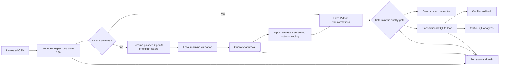
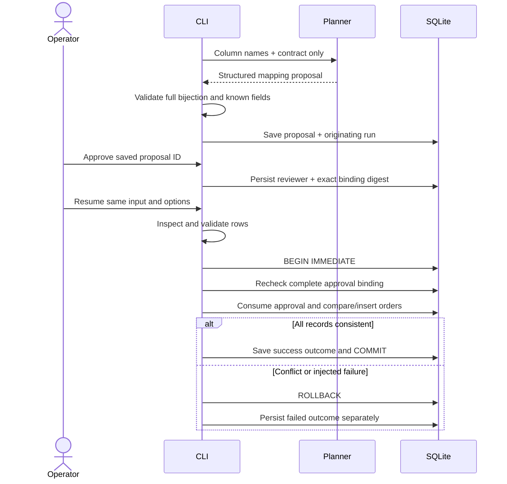

# Architecture

## Component boundaries

The application separates uncertain schema reasoning from deterministic data handling. A CSV batch is the execution unit; `order_id` is the warehouse identity. The source is inspected once into a bounded byte snapshot, and its SHA-256 binds the subsequent approval and load.

| Module | Responsibility | External effects |
|---|---|---|
| config | Contract identity and source resource limits | None |
| planner | Proposal generation and local mapping validation | Optional Responses API request |
| contract | Currency, ID, timestamp and status transformations | None |
| storage | Versioned schema initialization and transaction ownership | SQLite |
| pipeline | Approval, quality gate, loading, queries and audit | SQLite |
| cli | Argument validation, JSON output and process status | Filesystem and stdout/stderr |

## Approval and load sequence

A proposal is saved atomically with its pending outcome. Quality evidence and quarantine rows form a separate transaction before loading, so they survive a failed load. Approval consumption, all order changes, successful run state and successful audit events share one transaction. A failed load therefore leaves its approval available for a recovery attempt.

## Failure model

The SQLite connection is process-local and uses a 10-second lock timeout, explicit write transactions, foreign keys and FULL synchronous mode. A process crash releases SQLite locks; uncommitted writes are rolled back by SQLite. A crash can leave an attempt at `started`; the operator reconciles the run history and warehouse before rerunning. The implementation does not claim distributed exactly-once processing or automated stuck-run reconciliation.

Only the planner calls an LLM. Live mode uses bounded SDK retries, suppresses raw provider errors and never falls back to a fixture. Every source row stays local. Model output is data and cannot alter Python transformations or SQL statements.
